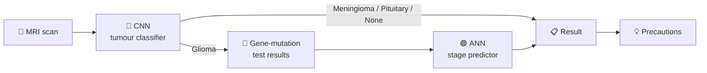

<!-- NeuroAssist AI · README by Usama Shahid (fewgets) -->
<div align="center">


<p>
  
  
  
  
  
  
</p>

<p>
  <a href="https://neuroassistai.vercel.app/"><b>🌐 Live Demo</b></a> · <a href="https://www.kaggle.com/datasets/masoudnickparvar/brain-tumor-mri-dataset"><b>📁 Dataset</b></a> · <a href="https://onlinelibrary.wiley.com/doi/full/10.1155/2022/1830010"><b>📜 Research Paper</b></a>
</p>

</div>

---
## 📌 Overview

**NeuroAssist AI** is a two-stage deep-learning system that supports doctors in brain-tumour diagnosis:

1. 🧠 **Tumour Detection:** a custom **CNN** classifies an MRI scan as *Glioma*, *Meningioma*, *Pituitary* or *No Tumour*.
2. 🧬 **Glioma Staging:** if a glioma is found, a custom **ANN** predicts its **stage** from gene-mutation test results.
3. 💡 **Guidance:** each result comes with clear, plain-language precautions.

It is served through a **FastAPI** backend and a **live web app**, so anyone can try it in the browser.

> 🌐 **Try it now:** [neuroassistai.vercel.app](https://neuroassistai.vercel.app/)

---

## 🖼️ Sample MRI Classes

| Glioma | Meningioma | Pituitary | No Tumour |
|:-:|:-:|:-:|:-:|
|  |  |  |  |

---

## 🔬 Pipeline



---

## 🧠 Model Architecture

### 🔷 CNN: Brain Tumour Classification

| Layer | Details |
|---|---|
| Input | Grayscale MRI image |
| Feature extractor | 3 × (Conv2D → ReLU → MaxPool) |
| Classifier | Flatten → Dense → Softmax |
| Output | 4 classes: Glioma, Meningioma, Pituitary, No Tumour |
| Accuracy | **≈ 93%** on the test set |

*Trained from scratch in PyTorch on an NVIDIA GPU.*

### 🟢 ANN: Glioma Stage Prediction

| Layer | Details |
|---|---|
| Input | 9 features: gender, age and mutation status of **IDH1, TP53, ATRX, PTEN, EGFR, CIC, PIK3CA** |
| Hidden | 2–3 fully connected layers with ReLU |
| Output | Glioma stage |

---

## 📚 Research Basis

Based on the paper **"Brain Tumor Classification and Glioma Stage Prediction Using Deep Learning"**
([Wiley, 2022](https://onlinelibrary.wiley.com/doi/full/10.1155/2022/1830010)).
The paper published no code, so the full pipeline was **implemented from scratch**.

**Dataset:** [Brain Tumor MRI Dataset (Kaggle)](https://www.kaggle.com/datasets/masoudnickparvar/brain-tumor-mri-dataset): 4 classes of grayscale MRI images.

---

## 🔌 API Endpoints

| Method | Endpoint | Purpose |
|---|---|---|
| `GET` | `/` | Health check |
| `POST` | `/predict-image` | Upload an MRI image and get the tumour class |
| `POST` | `/predict-glioma-stage` | Send gene-mutation values and get the glioma stage |

---

## 🚀 Run Locally

```bash
git clone https://github.com/fewgets/NeuroAssistAI.git
cd NeuroAssistAI
pip install torch torchvision opencv-python pillow numpy scikit-learn fastapi uvicorn python-multipart
```

**Model files**

| File | Model | Where |
|---|---|---|
| `glioma_stages.pth` | Glioma stage ANN | ✅ Included in `models/` |
| `BTD_model.pth` | Tumour CNN | 📥 [Download from Google Drive](https://drive.google.com/file/d/19SVLCD3DTa1aBZ9PI4TTgNkvJKgL2LSY/view?usp=drive_link) and place it in `models/` (too large for GitHub) |

```bash
uvicorn API:app --reload      # API at http://127.0.0.1:8000/docs
# or
python main.py
```


---

## 📁 Project Structure

```text
NeuroAssistAI/
├── API.py              # FastAPI endpoints
├── main.py             # Entry point
├── utils.py            # Input helpers and precautions
├── models/
│   ├── TumorModel.py   # CNN and ANN definitions
│   └── glioma_stages.pth
└── images/             # Sample MRI scans
```

---

## 🔭 Roadmap

- [ ] LLM-powered medical Q&A for patients
- [ ] Grad-CAM heatmaps to show *where* the model is looking
- [ ] Doctor dashboard with patient history
- [ ] Mobile app

> ⚠️ **Disclaimer:** for research and education only. It is not a medical device and must not be used for clinical decisions without professional validation.

---

## 🤝 Let's Work Together

<div align="center">

**Have an idea, a freelance project, or want to collaborate on something in AI?**
I'm always open to collaborations, freelance work and full-time opportunities.

<a href="mailto:shaikhusama541@gmail.com?subject=Collaboration%20-%20NeuroAssist%20AI">
  
</a>
<a href="https://www.linkedin.com/in/-usamashahid/">
  
</a>
<a href="https://github.com/fewgets">
  
</a>

<br/><br/>

⭐ **If you like this project, please give it a star. It really helps!** ⭐

<br/>

<h3>"AI won't replace doctors, but it can give them a second pair of eyes."</h3>


</div>
